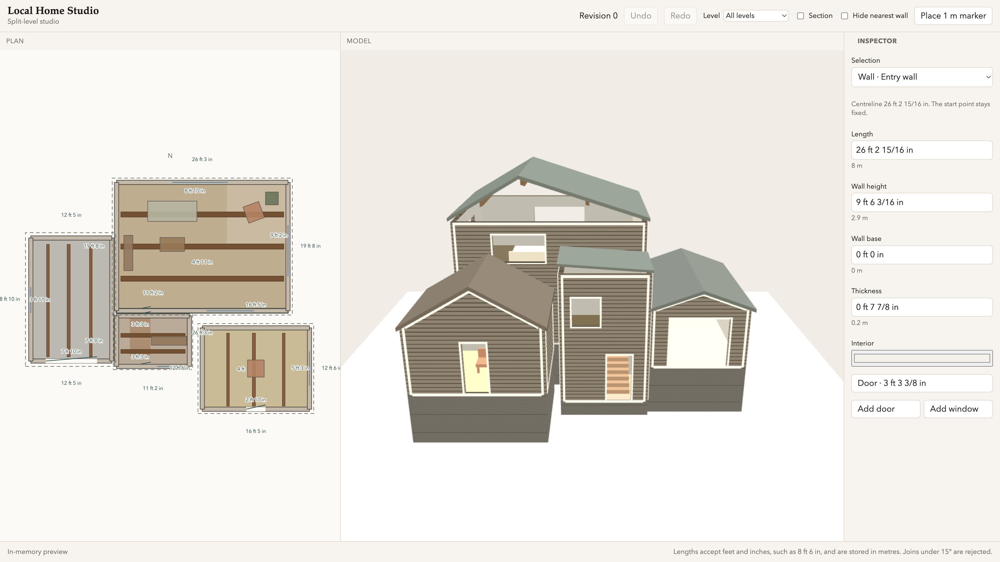
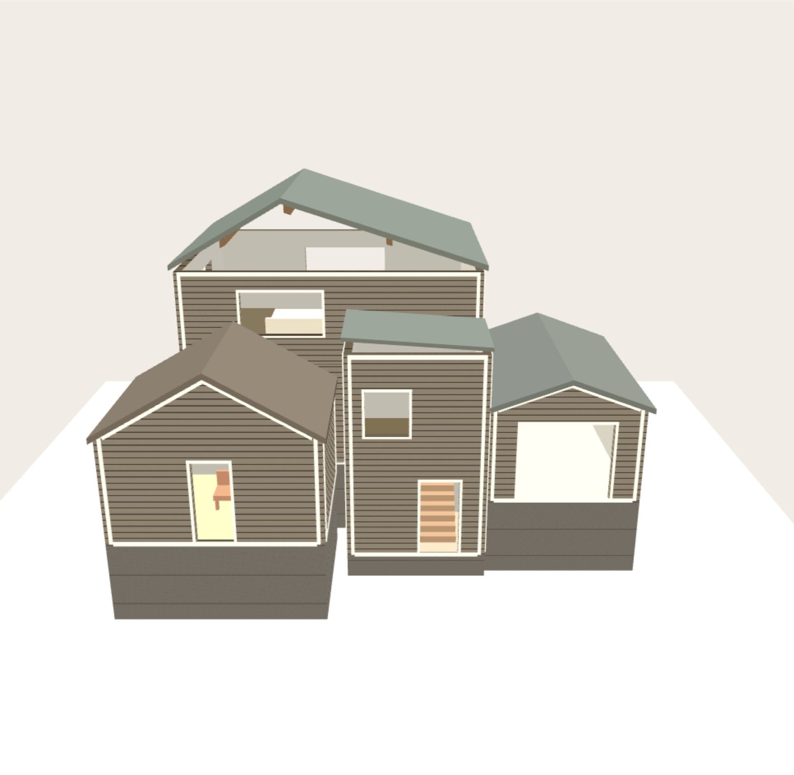
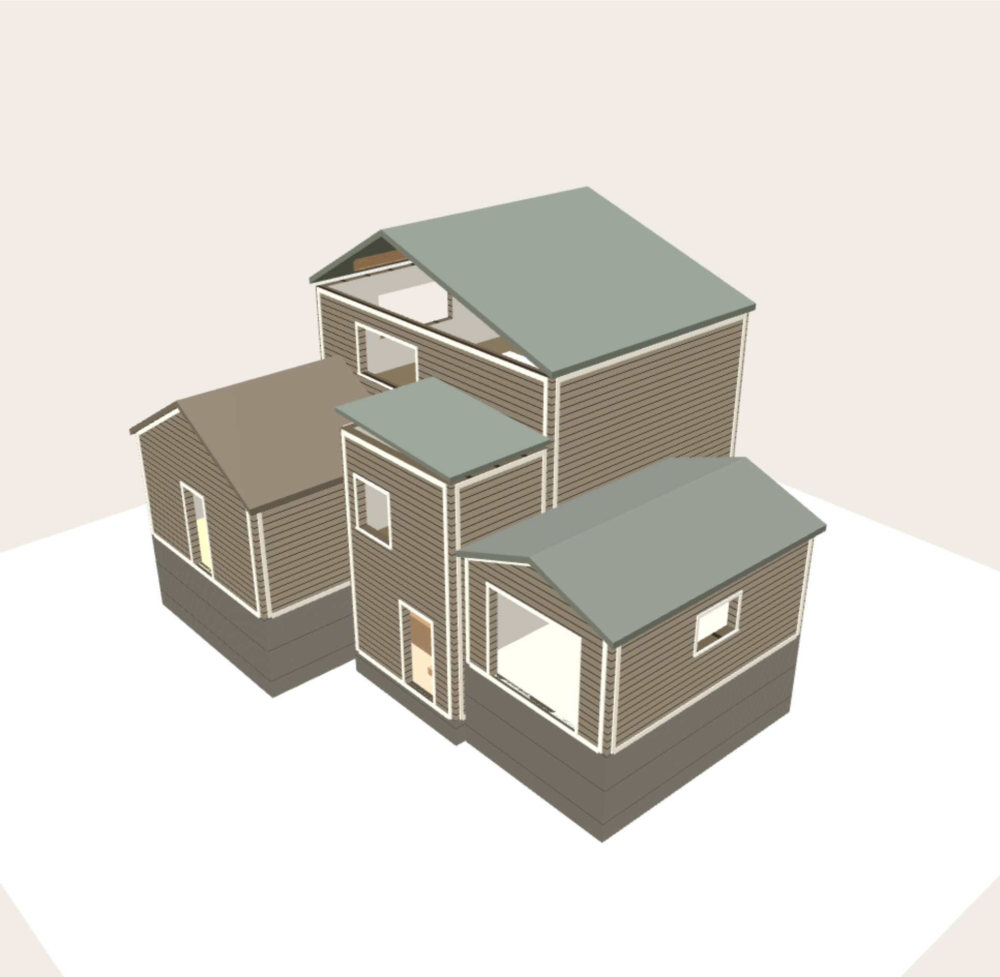
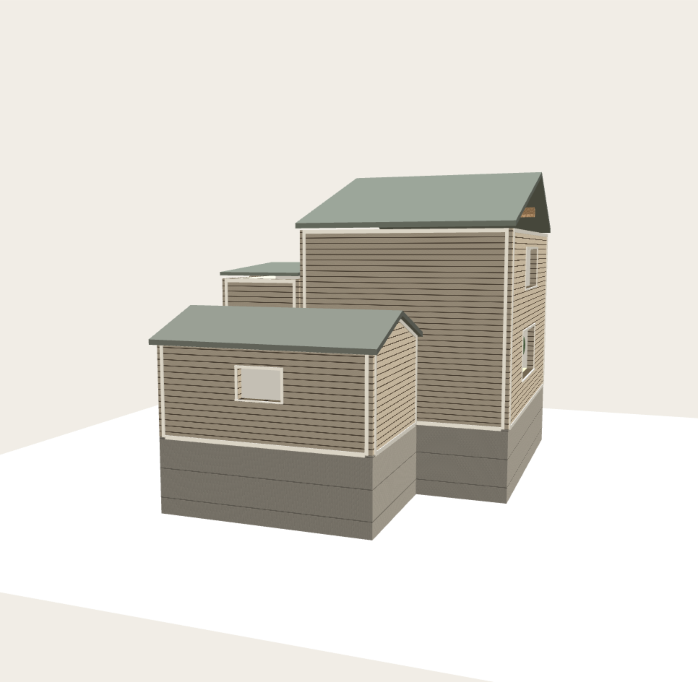

# Local Home Studio

A project testing Grok's newest model and Cursor's latest updates. The goal is a home-design program an AI model can use to turn a user's photos into an editable model of their house.

The sample is a split-level studio: a two-storey main room, a lower mudroom, a garden room with a 30° gable, a garage at the main-floor level, and a concrete foundation.

